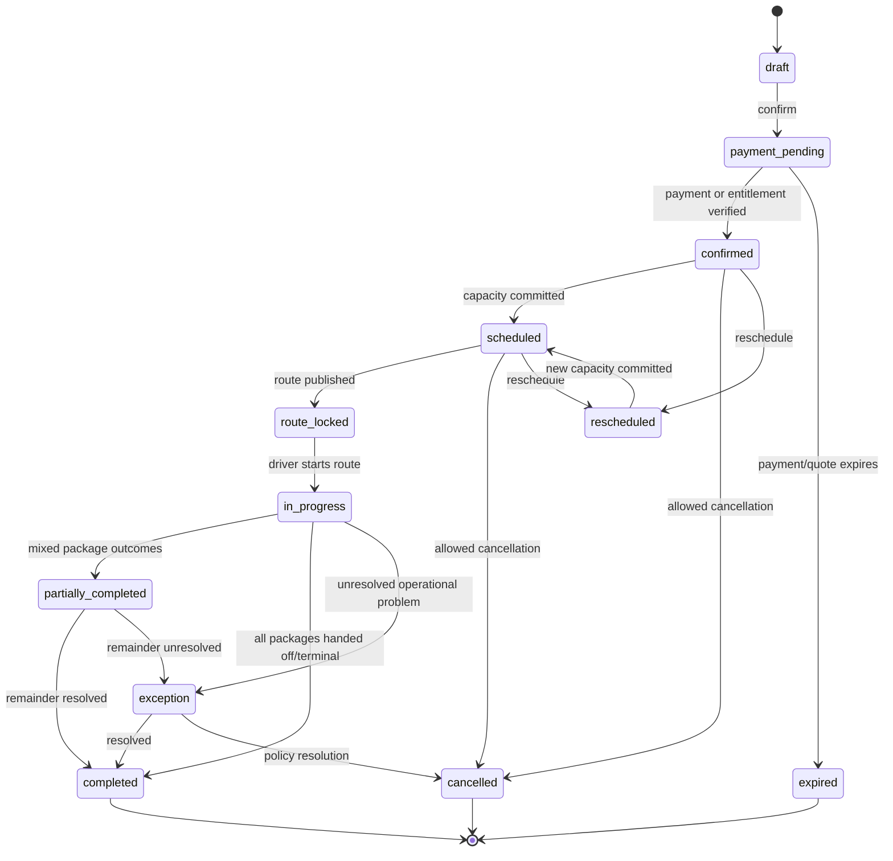
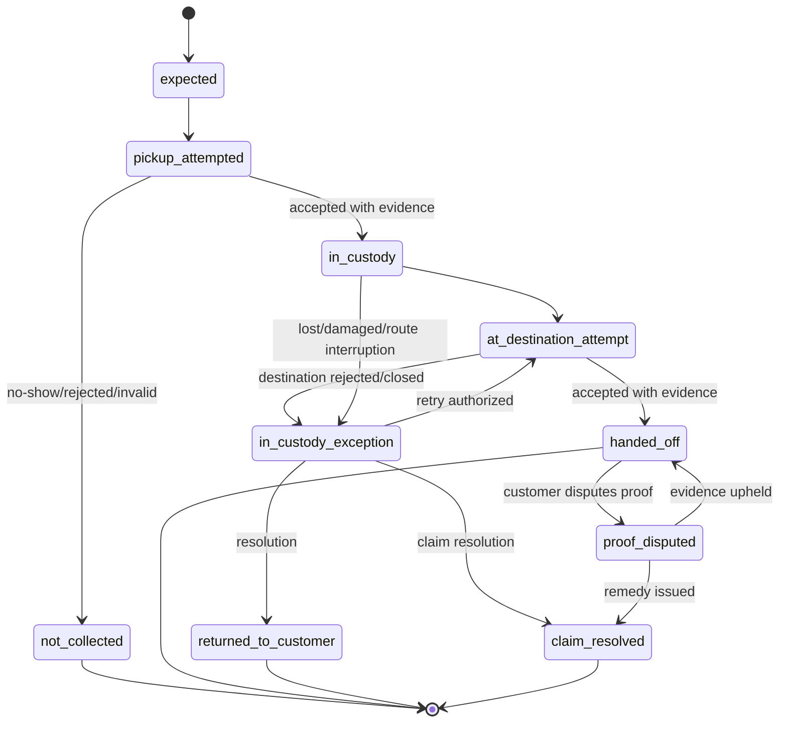

# 02 — User flows and rules

[Documentation index](../README.md) · Previous: [Product requirements](01-product-requirements.md) · Next: [AWS system architecture](03-aws-system-architecture.md)

## 1. Operating principles

1. The **confirmed pickup window is a hard service constraint**. The preferred time is a soft routing objective and is never promised.
2. A **booking** is the commercial/customer arrangement; each physical **package** has its own identity and custody state.
3. A package is accepted only after identity/preparation checks. Physical possession and final destination handoff are separate evidenced transitions.
4. Status transitions are append-only facts with explicit commands; clients do not directly set arbitrary status values.
5. Automation may recommend, but dispatch owns exceptions and route publication in the MVP.
6. Customer messages use plain language, estimate ranges, and the customer's selected language.

## 2. Standard customer journey

### Quote and book

1. Customer checks address/serviceability and signs in when ready to book.
2. Customer adds package details: retailer, carrier/return method if known, label/QR status, size/weight band, return deadline, and destination instructions. Multiple packages must each be independently identifiable.
3. System validates configured eligibility and warns that Returnet does not authorize the retailer return or guarantee the retailer refund.
4. Customer chooses an available hard window and optionally a preferred time within it.
5. Server creates an expiring quote in CAD with tax and subscription coverage. Client displays cancellation/reschedule terms and package-preparation/restricted-goods attestations.
6. Server establishes payment or reserves a valid subscription entitlement. A single idempotent confirmation creates the booking, packages, payment allocation, capacity reservation, audit event, and confirmation-outbox message.
7. Customer receives confirmation and preparation instructions. The booking remains visible even if notification delivery fails.

### Before pickup

- A configurable reminder asks the customer to seal the package, attach or prepare the correct label/QR, and keep it accessible.
- Operations validates ambiguous destination/label data before route freeze.
- Customer may reschedule/cancel according to the displayed policy. Once route-locked or in progress, self-service may close and support takes over.
- Route planning assigns the stop. Publishing the route makes its version available to the driver and may generate a “route/window started” message.

### Pickup

1. Driver starts shift and grants/validates location permission. Background/foreground location is collected only according to consent, platform policy, and active-work rules.
2. Driver sees the next stop, constraints, access notes, safe-contact action, navigation link, and ETA band.
3. ETA engine may send “about 15 minutes away” and “about 1 minute away” once per threshold, subject to confidence and throttling.
4. At the address, driver marks arrival and attempts contact without exposing a personal number.
5. Driver scans the booking/package code or selects a controlled fallback; checks label, packaging, count, and prohibited-item attestation; captures required evidence.
6. For valid packages, an atomic `accept_pickup` transition records evidence and custody. Customer receives successful-pickup confirmation.
7. For any discrepancy, driver does not improvise acceptance. The package stays with the customer unless an approved exception flow explicitly permits acceptance.

### Destination handoff

1. Driver follows the route's destination stops and operating-hour constraints.
2. Driver scans or selects package(s), records carrier/retailer handoff evidence, receipt/reference/tracking number when supplied, timestamp, and location where enabled.
3. Each package transitions independently. A partially accepted batch remains open with explicit unresolved packages.
4. Customer receives destination-handoff proof after validation. Returnet states that retailer refund timing remains controlled by the retailer/carrier.
5. End-of-route reconciliation requires every assigned package/stop to have a terminal or owned exception state.

## 3. State machines

### Booking lifecycle

`rescheduled` is a historical transition; the booking's active schedule points to a new version. `completed` means Returnet's packages reached their configured terminal outcomes, not that the retailer issued a refund.

### Package custody lifecycle

Financial outcomes are separate: a failed pickup may be charged, credited, or refunded based on reason and policy. Never encode money outcome solely in an operational state.

### Route lifecycle

`draft → optimizing → proposed → published → active → completed`, with `optimization_failed` returning to `draft`, and `active → partially_completed → completed`. A published/active route is revised by creating a new route version; prior stop order and constraints remain auditable.

## 4. Exception playbooks and defaults

These are design defaults for implementation and pilot training; business/legal owners must ratify fees, liability, contact attempts, and evidence policy.

| Scenario | Immediate system behavior | Operations/customer outcome |
|---|---|---|
| Cancellation | Validate cutoff against booking/window timezone; release capacity; cancel only uncollected packages; calculate preview before command | Record reason and policy version; refund/credit asynchronously; confirm amount/status |
| Reschedule | Hold new slot briefly, atomically move capacity, invalidate route assignment if needed | Requote price/tax if rules changed; preserve schedule history; notify driver if route was published |
| Customer no-show | Driver marks arrival, follows configured contact/wait steps, records evidence without photographing private interior | `not_collected:no_show`; dispatch decides retry/fee/credit; customer receives next steps |
| Missing/invalid label or QR | Do not accept by default; capture non-sensitive issue evidence and reason | Customer corrects/reschedules or operations approves a documented supported fallback |
| Rejected/unsafe package | Refuse possession; choose reason (damage, prohibited item, size/weight, mismatch, unsafe location) | Escalate safety issues; fee/refund per reviewed policy; never ask driver to transport restricted goods |
| Driver delay | Recompute risk/ETAs; suppress misleading threshold messages; alert dispatch | Notify affected customers with revised estimate and choices; retain hard-window breach event |
| Failed destination drop-off | Package remains in custody; capture closure/rejection/reason and evidence | Dispatch selects alternate authorized location, retry, secure overnight storage, or return-to-customer; customer informed |
| Partial route completion | Close only completed stops/packages and preserve assignments for the rest | Reassign/carry over each remainder with custody reconciliation; no bulk “complete” shortcut |
| Refund/credit | Create financial adjustment request with idempotency key and reason | Stripe result updates local ledger projection; failures enter finance queue; credit and refund are distinct |
| Lost/damaged package | Freeze normal progression; open incident/claim; preserve evidence and limit access | Named investigator, customer communication cadence, insurer/policy workflow, and recorded remedy |
| Notification failure | Retry transient failures with backoff; token invalidation for permanent push errors; dead-letter exhausted work | Core operation continues; critical undelivered messages appear to operations; use email/SMS fallback only when consented/configured |
| Duplicate webhook/client retry | Deduplicate by provider event ID/idempotency key; return prior result | No duplicate side effects; mismatched reuse returns conflict |
| Offline driver | Queue signed commands/evidence metadata locally, mark as pending, prohibit impossible local transitions | Sync in order; upload media by presigned URL; conflicts pause affected item for dispatch, while unrelated work continues |
| Proof dispute | Append dispute/case; make evidence read-only; restrict download | Review timeline and evidence access logs; uphold, correct derived display, or issue documented remedy without rewriting history |

## 5. Scheduling and capacity rules

- Store timestamps in UTC and the service timezone as `America/Toronto`; render local time with DST-aware libraries. Store the UTC offset used for customer-facing schedule snapshots.
- Window definitions and capacity are versioned by service zone/date. Booking uses a short capacity hold and a database constraint/transaction to prevent the last slot from being oversold.
- Lead time, booking cutoff, cancellation cutoff, maximum packages, weight/volume bands, route capacity, and blackout dates are configuration—not client constants.
- Preferred time must lie within the hard window. If absent, the optimizer uses neutral preference. The UI says it is a preference.
- Destination operating hours must accommodate the downstream handoff plan. Work is infeasible if no authorized destination can be reached within its hours and custody/storage rules.
- Weather/emergency closures allow operations to stop new bookings, hold route publication, and bulk propose reschedules, but each booking keeps its individual audit trail.

## 6. Pricing, subscriptions, refunds, and taxes

- All prices are server-calculated integer minor units in CAD. Store quote lines, tax jurisdiction/rate identifiers, discounts, tax, total, and pricing-policy version.
- The default subscription grants a configurable pickup entitlement, not unlimited service until economics and fair-use terms are approved. Usage is reserved at booking and consumed at pickup or another policy-defined point; cancellations restore it according to policy.
- Stripe is authoritative for processor state. Returnet is authoritative for service fulfilment and keeps a reconciled local payment/adjustment projection.
- Display whether a remedy is a card refund, account credit, or restored entitlement and its expected processing behavior.
- Quebec/Canadian sales-tax registration, GST/QST application, invoice/receipt content, credit-note handling, and subscription tax treatment require accounting advice before launch.

## 7. Identity, authorization, and support boundaries

- Customers access only their household/account bookings and redacted evidence.
- Drivers access current/recent assigned routes and minimum customer/contact data needed for the job; access expires after an operational retention window.
- Dispatch can manage routes and operational exceptions but cannot change roles or unrestricted financial configuration.
- Support can inspect timelines and apply remedies only within limits; high-value adjustments require finance/manager approval.
- Finance reconciles charges/refunds/subscriptions but does not need precise live driver location.
- Administrators manage roles/configuration. No one can edit immutable custody/audit events; corrections are appended.

## 8. UX copy rules

- Say “pickup window” for the commitment and “estimated arrival” for a moving estimate.
- Never display “on time” based only on straight-line distance.
- Make destructive/financial consequences explicit before confirmation.
- Keep reason codes machine-readable but show localized, empathetic customer copy.
- French content is professionally reviewed; do not rely on runtime machine translation for legal, safety, payment, or exception copy.

