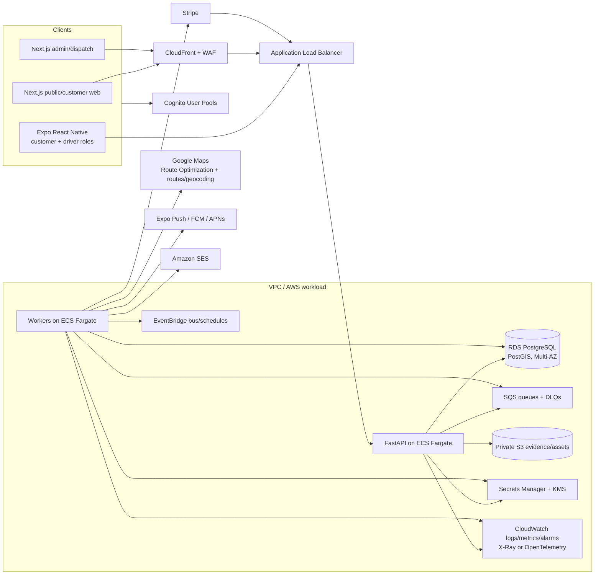

# 03 — AWS system architecture

[Documentation index](../README.md) · Previous: [User flows and rules](02-user-flows-and-rules.md) · Next: [Data model and API](04-data-model-and-api.md)

## 1. Architecture decision

Use a **modular monolith plus independently scaled workers** for the MVP. One FastAPI codebase owns transactional modules (identity profile, booking, capacity, routing, fulfilment, payments, notifications, support, audit), deployed as an API service and several worker process types on ECS Fargate. PostgreSQL is the transactional source of truth. Internal modules communicate synchronously inside a transaction when consistency is required and asynchronously through a transactional outbox otherwise.

This avoids premature distributed transactions while preserving extraction seams through module ownership, explicit contracts, and events. Split a service only when scaling, reliability, security, or team ownership data supports it.

## 2. Logical architecture

The diagram is logical: static web assets use S3/CloudFront where deployment mode permits; Next.js server rendering can run as its own ECS service behind CloudFront/ALB. Exact edge origins should follow the chosen Next.js deployment adapter and cache needs.

## 3. Deliberate service choices

| Concern | MVP choice | Why / upgrade path |
|---|---|---|
| Compute | ECS Fargate for FastAPI, Next.js SSR where needed, and workers | Operationally straightforward containers, independent scaling, no Kubernetes. Consider Lambda only for small isolated event handlers, not as a second default runtime. |
| Database | RDS PostgreSQL, Multi-AZ production, PostGIS extension | Transactions, spatial service zones, familiar migrations. Add read replica/RDS Proxy only after connection/load evidence; evaluate Aurora PostgreSQL if scale/recovery economics justify it. |
| Async | SQS per workload class with DLQs; EventBridge for schedules/integration fan-out | SQS gives durable work and backpressure. EventBridge is not the job queue. FIFO is used only where proven ordering/dedup needs outweigh throughput/complexity. |
| Files/evidence | Private S3, KMS encryption, versioning where appropriate, lifecycle rules, presigned upload/download | Keeps binaries out of PostgreSQL. Add malware scanning/quarantine pipeline before evidence becomes reviewable. CloudFront signed access only if customer-scale delivery warrants it. |
| Identity | Cognito User Pools; app database stores profile and roles/assignments | Hosted/managed auth and standards-based tokens. Staff federation through an enterprise IdP can be added later. Authorization remains server-side and domain-aware. |
| Edge | CloudFront + AWS WAF for web/API where compatible; ALB to ECS | TLS, caching, bot/rate controls. Mobile APIs may use the same domain. Shield Standard is inherent; avoid buying advanced services without threat/economic need. |
| Secrets/keys | Secrets Manager and KMS; task roles via IAM | No application secrets in images or CI variables where workload identity works. Rotate supported secrets. |
| Observability | CloudWatch logs/metrics/alarms, OpenTelemetry traces exported to X-Ray | One pragmatic AWS-native baseline. Add a specialist observability vendor only if query/on-call needs justify data egress/cost. |
| Email | SES for transactional email | AWS-native, controllable templates from app. SMS is deferred/limited; evaluate Pinpoint replacement/current AWS messaging option or another provider when consent and need are clear. |
| IaC | AWS CDK in TypeScript (decision default) | Fits TypeScript frontend skills, creates repeatable stacks. Terraform is acceptable if the operating team has stronger expertise; do not run both as equal owners. |

## 4. Non-AWS dependencies

### Google Maps Platform

Use Route Optimization API as the MVP solver because it directly represents hard/soft time windows and vehicle constraints. Use Google routing/geocoding consistently enough to avoid mismatched travel-time matrices, subject to contract/licensing review. Isolate it behind `RoutingProvider` and persist normalized inputs, provider request ID, solver parameters/version, and output summary—not unrestricted provider payloads if licensing prohibits storage.

Fallback path: Amazon Location Service for maps/geocoding/routes plus a self-hosted OR-Tools optimization worker on ECS. This requires building matrix batching, constraint modelling, tuning, infeasibility diagnostics, and operational benchmarks. It improves vendor independence but is not simpler for MVP. Details are in [routing](05-routing-notifications-and-tracking.md).

### Stripe

Use Stripe Checkout or Payment Element/Setup Intents as appropriate, Billing for subscriptions, and Tax only if accounting/legal review selects it. Stripe reduces PCI scope, but Returnet remains responsible for secure integration, reconciliation, refunds, disputes, taxes, and accurate terms. Provider calls are wrapped behind payment interfaces and all webhooks are persisted/deduplicated.

### Mobile push

Expo Push Service is acceptable for MVP delivery to FCM/APNs, with provider receipt processing and direct FCM/APNs as an upgrade if control/scale requires. Push is best-effort; critical information remains in-app and may use email fallback.

## 5. Network and trust boundaries

- Production uses at least two Availability Zones. ALB runs in public subnets; ECS tasks and RDS run in private subnets. RDS has no public endpoint.
- Security groups allow only ALB-to-service and service-to-database/required egress. Prefer VPC endpoints for S3, SQS, Secrets Manager, ECR, and CloudWatch where cost/operations support them.
- Outbound access to Stripe/Google/push is controlled and observable. NAT gateways are sized for availability/cost; an egress proxy is a later hardening option.
- Separate customer and staff OAuth clients/audiences. Validate issuer, audience, signature, expiry, and token use on every request. Domain authorization never trusts client role claims alone.
- Admin access receives stricter WAF/rate controls, MFA, shorter sessions, and optionally IP/device restrictions after staff workflow validation.
- Evidence objects are private and referenced by opaque IDs. Presigned URLs are short-lived and issued only after API authorization.

## 6. Request and event flow

### Transactional command

1. Client sends authenticated command and `Idempotency-Key`.
2. API validates authorization, request version, and business preconditions.
3. In one PostgreSQL transaction, API locks/updates aggregates, appends domain/audit facts, records the idempotent response, and inserts outbox rows.
4. API returns the stable resource/result. A relay claims outbox rows using `FOR UPDATE SKIP LOCKED`, publishes to SQS/EventBridge, and marks publication.
5. Consumers deduplicate by event/message ID, perform side effects, and record outcomes. Retries use exponential backoff with jitter; poison messages move to a DLQ and raise an alarm.

Exactly-once transport is not assumed. Correctness comes from atomic local writes plus idempotent consumers.

### Evidence upload

API creates an expected evidence record and short-lived presigned multipart/single upload URL with content-type/size constraints. Client uploads directly to a quarantine S3 prefix. Completion command verifies object metadata/checksum, queues scanning/processing, then marks it available. Orphan/quarantine objects expire automatically.

## 7. Environments and accounts

Recommended AWS Organizations layout:

- `security/log-archive` (as maturity allows), `shared-services`, `development`, `staging`, and `production` accounts.
- Developer sandboxes use synthetic data and cost controls. Staging resembles production topology at reduced capacity and never receives copied production personal data by default.
- Each environment has independent Cognito pools/clients, databases, buckets, keys, queues, domains, Stripe mode/accounts configuration, and Google credentials/quotas.
- Resource tags include application, environment, owner, cost center, data classification, and IaC stack/version.

## 8. CI/CD and supply chain

1. Pull request: formatting/lint, type checks, unit/property tests, migration checks, contract tests, dependency/secret/IaC/container scans, and build immutable artifacts.
2. Merge: sign/tag container images by commit SHA, push to ECR, generate SBOM/provenance, deploy automatically to development, run integration/E2E/smoke tests.
3. Promotion: promote the same image digests to staging, run migration rehearsal, routing simulations, accessibility/mobile gates, DAST, and manual operational acceptance.
4. Production: approval for MVP, apply backward-compatible expand migration, deploy canary or rolling service with health gates, run smoke checks, then contract migration later. Feature flags decouple exposure from deployment.
5. Protect branches, require review for code/IaC/migrations, use CI OIDC roles rather than long-lived AWS keys, and restrict production deployment roles.

## 9. Database migrations and rollback

- Alembic is the only schema-change path. Migrations are immutable after shared deployment and tested from both empty schema and a sanitized production-like previous snapshot.
- Use expand/contract: add nullable/table/index concurrently where supported; deploy code that handles both shapes; backfill in bounded resumable jobs; enforce constraints/remove old fields in a later release.
- Take/verify backup posture before high-risk changes. Schema rollback is usually a forward corrective migration; never assume a destructive down migration restores deleted data.
- Application rollback redeploys the previous immutable image only if it remains compatible with the expanded schema. Feature flags provide the fastest functional rollback.

## 10. Availability, backup, and disaster recovery

- Multi-AZ RDS with automated backups and point-in-time recovery; encrypted cross-account/cross-region copy is a post-pilot choice based on approved RPO/RTO and residency/legal analysis.
- S3 versioning/object retention is enabled selectively; lifecycle transitions and deletion follow the retention schedule rather than “keep forever.”
- SQS retains work long enough for incident recovery; DLQs are redrive-controlled, not automatically emptied.
- Define and approve RPO/RTO before launch, then prove them with restore exercises. A draft engineering objective for planning may be RPO ≤15 minutes and RTO ≤4 hours, explicitly not a commitment until tested and staffed.
- Provider outage modes: preserve bookings locally, stop promising new capacity if routing is unavailable near planning cutoff, queue notifications, and make payment state pending rather than assuming success.

## 11. Local development and test data

- Docker Compose runs PostgreSQL/PostGIS, a local SQS-compatible emulator only if it faithfully serves developer speed, API, worker, and web. Critical integration tests also run against real managed services in a disposable AWS test environment.
- Use `.env.example` with variable names and safe defaults; real credentials come from developer identity/secret tooling and are never committed.
- Alembic creates schema; deterministic seed commands create Montreal-shaped synthetic zones, addresses, windows, users, routes, packages, and events. Never seed production automatically.
- Stripe CLI/test mode and provider stubs replay signed fixtures; routing has deterministic recorded/synthetic responses within provider licensing terms.
- Mobile builds use Expo development builds for native permissions/background-location/offline testing; Expo Go alone is insufficient for release confidence.

## 12. Capacity and cost controls

Start with modest Fargate desired counts across AZs, autoscale API on CPU/request/latency and workers on queue age/depth, and set RDS/connection limits deliberately. Budget alarms, anomaly detection, log retention, S3 lifecycle, NAT/data-transfer review, provider quotas, and per-environment shutdown rules prevent silent cost growth. Route-optimization calls are cached only when inputs are identical and licensing allows; manual retries require deduplication and cost visibility.

## 13. Architecture risks to validate

- Cognito custom flows and bilingual hosted UI limitations may require a custom app UI.
- Next.js hosting topology affects caching, SSR operations, and deployment strategy; prove it with a thin vertical slice.
- PostGIS extension/version availability must be confirmed in the selected RDS engine/region.
- Background location behavior differs by iOS/Android and app-review policy; test early on physical devices.
- Google and Stripe data processing, storage locations, contractual terms, and subprocessors require privacy/legal review.
- Montreal address quality and destination-hours data need operational verification; geocoding confidence cannot be blindly accepted.

