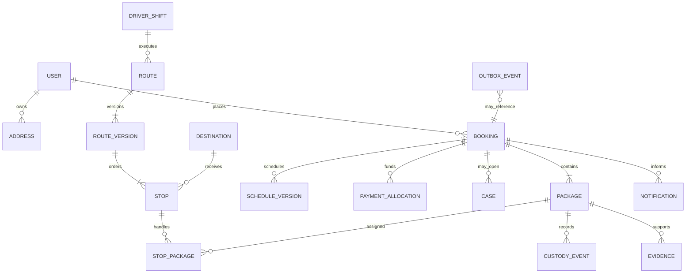

# 04 — Data model and API

[Documentation index](../README.md) · Previous: [AWS system architecture](03-aws-system-architecture.md) · Next: [Routing, notifications, and tracking](05-routing-notifications-and-tracking.md)

## 1. Modelling conventions

- PostgreSQL UUID primary keys are opaque and generated server-side (UUIDv7 when library/platform support is mature; otherwise UUIDv4). Public references are separate, short, non-sequential values.
- Every mutable row has `created_at`, `updated_at`, and integer `version`; times are `timestamptz` in UTC. Customer schedule snapshots also retain service timezone/offset.
- Money is integer minor units plus ISO currency. Quantities use explicit units; never store ambiguous floats for money/weight/distance.
- Status values are constrained enums or reference data, but status changes occur through domain commands and append-only transition records.
- Soft deletion is not a universal substitute for retention. Operational records use explicit lifecycle/retention fields; personal-data erasure anonymizes or detaches data where legal records must remain.
- External IDs are unique per provider/account. All JSON payload snapshots are schema-versioned, access-controlled, minimized, and subject to retention.
- PostGIS uses `geography(Point, 4326)` for coordinates and `geometry(MultiPolygon, 4326)` for service zones with appropriate GiST indexes.

## 2. Core domain model



The diagram omits configuration, audit, idempotency, consent, and provider-event tables for readability.

## 3. Objects and critical fields

### Identity and policy

**User / profile** — `id`, Cognito `subject`, type (`customer`, `staff`, `driver`), name, normalized email/phone and verification state, locale (`en-CA`/`fr-CA`), timezone, accessibility/notification preferences, account status. Authentication secrets stay in Cognito.

**Role assignment** — `user_id`, role, scope/organization, effective interval, grantor, reason. Staff authorization reads current assignments from the application, not an unverified client claim.

**Consent receipt** — subject, purpose (terms, privacy notice, optional marketing, driver active-location), document/version/hash, locale, captured time/source, withdrawal time. Required service processing and optional consent must not be conflated.

**Policy/config version** — key/type, effective interval, structured value, approver, source/version. Used for price, cancellation, package eligibility, evidence, retention, and operational rules.

### Geography, capacity, and booking

**Address** — owner/reference, normalized lines, municipality/province/postal/country, access notes (separately protected), geocode point, precision/confidence, provider/place ID, validation status. Preserve the entered form and normalized snapshot used for service.

**Service zone** — name, polygon, timezone, active interval, operating calendar, zone configuration version.

**Capacity bucket** — zone, service date, hard-window start/end, capacity units/used/held, version. A **capacity hold** has token, booking draft, units, expiry, and state. Atomic constraints prevent negative/over capacity.

**Quote** — customer/draft, expiry, currency, line items, subtotal/discount/tax/total, tax identifiers, pricing-policy version, subscription entitlement proposal, request fingerprint.

**Booking** — public reference, customer, active schedule version, pickup-address snapshot/reference, locale/timezone, status, package count, quote, payment/entitlement state, policy versions, cancellation/exception summary, optimistic version.

**Schedule version** — booking, sequence, hard-window start/end UTC, displayed local values/offset, preferred time UTC (nullable), zone/capacity bucket, created reason/actor. Old versions remain immutable.

**Package** — booking, public/scannable token (do not encode personal data), ordinal, retailer, carrier/return method, destination, return authorization/label metadata (encrypted/minimized), size/weight band and measured values if needed, deadline, eligibility/preparation status, current custody projection, risk flags.

### Dispatch and fulfilment

**Driver shift** — driver, start/end/depot point, breaks, vehicle/capacity dimensions, skill/compatibility tags, status and location-consent status.

**Route / route version** — service date/zone, driver/shift, lifecycle; version stores immutable solver input hash, provider/job ID, objective/constraint summary, generated/published time, approver, start/end, distance/duration estimates, superseded-by, and infeasibility diagnostics.

**Stop** — route version, stable logical stop ID, sequence, type (`pickup`, `destination`, `break`, `depot`), hard time window, preferred time/weight, planned arrival/departure/service time, address/destination snapshot, status, actual times. Co-located packages can share a stop while retaining individual evidence.

**Stop-package** — stop, package, expected action, scan requirement, outcome/reason. Unique constraints prevent a package from being assigned to incompatible active steps.

**Driver location sample** — driver/shift/route, captured-at device/server received-at, point/accuracy/speed/source, consent basis, retention expiry. Store at an operationally useful cadence, not continuously by habit.

**Custody event** — package, monotonically ordered sequence, event type, from/to projection, actor/device, occurred-at and received-at, point/accuracy if allowed, route/stop, reason, idempotency key, prior-event hash or tamper-evident batch reference. Immutable.

**Evidence** — package/event, type (`photo`, `scan`, `receipt`, `tracking_reference`, `signature_attestation`), private S3 key/version, checksum, MIME/size, capture/receive time, scan result, point/accuracy if allowed, malware/processing state, retention class. Sensitive provider/customer tokens are encrypted and redacted in views.

### Payments, messaging, and support

**Payment customer/instrument reference** — Stripe customer/payment-method token and safe display fields only.

**Payment transaction** — provider object ID, type (`intent`, `charge`, `refund`, `dispute`, `invoice`, `credit`), amount/currency/tax, status, booking/subscription, idempotency key, provider timestamps. This is a projection/reconciliation record, not a replacement general ledger.

**Subscription / entitlement reservation** — Stripe subscription/price, local status/current period; entitlement type/quantity, reserved/consumed/released time, booking, policy version.

**Provider webhook inbox** — provider, event ID/type/created time, signature-validation outcome, minimal encrypted/raw payload reference if justified, received/processed status, attempts, error. Unique `(provider, event_id)`.

**Notification** — subject/booking/event, purpose, locale, template/version, channel, recipient reference, deduplication key, scheduled/sent/delivered/failed times, provider ID, attempt count, terminal reason. Content snapshot retention is minimized.

**Case** — booking/package/customer, type/severity/status/owner, customer-visible summary, internal notes references, financial remedy, resolution reason/times. Cases append events; they do not rewrite custody.

**Audit event** — actor/effective actor, action, resource type/ID, outcome, reason, request/correlation ID, time, IP/device context (minimized), before/after changed-field summary with sensitive values redacted, retention class.

**Idempotency record** — principal, endpoint/operation, key, request hash, status/result reference or response, expiry. Reusing a key with another request hash returns conflict.

**Outbox event / consumer receipt** — event ID/type/schema version/aggregate ID+version/payload/correlation/causation, availability/publish state; consumer name + event ID uniquely records side-effect completion.

## 4. Aggregate and transaction boundaries

- **Booking aggregate:** booking, active schedule, package declarations, and capacity reservation/commit. Confirmation transaction includes payment/entitlement verification reference and outbox facts; remote Stripe calls occur outside the database transaction using a recoverable saga.
- **Package custody aggregate:** lock one package while validating the next allowed transition and appending custody/evidence references. Multi-package stops complete each package independently, then derive stop/booking projections.
- **Route aggregate:** route version is immutable once published. Replanning creates a successor; assignment changes use version checks and notify affected actors.
- **Financial projection:** consumes Stripe events and reconciliation queries idempotently. Never wrap a Stripe request and database commit in a fictitious distributed transaction.

Use row locks/unique constraints for last-slot capacity and critical custody transitions. Use optimistic `version`/`If-Match` for routine operator edits and return `409`/`412` with current representation on conflict.

## 5. API style and versioning

- JSON REST under `/v1`; OpenAPI is generated from FastAPI and checked into CI as a reviewed artifact. Breaking changes use a new major path or negotiated contract, not silent field reinterpretation.
- JSON fields use `snake_case`, ISO 8601 timestamps with offsets, IANA timezones, GeoJSON where exposed, ISO 4217 currency, and stable machine-readable error codes.
- Collections use cursor pagination and explicit sort. Filters are allow-listed. API never exposes database pagination offsets for high-change timelines.
- Commands that cause state transitions use named action endpoints because they carry domain semantics, e.g. `POST /v1/driver/stops/{id}:arrive`.
- All state-changing calls accept `Idempotency-Key`; commands also accept expected `version` where concurrency matters. Responses include `request_id` and resource version.
- Long-running work returns `202 Accepted` with an operation resource; clients poll with backoff or receive push/event updates.

### Error envelope

```json
{
  "error": {
    "code": "booking.window_no_longer_available",
    "message": "This pickup window is no longer available.",
    "details": {"suggested_action": "refresh_availability"},
    "request_id": "req_..."
  }
}
```

Messages are localized at the presentation boundary; `code` remains stable. Use `400` malformed request, `401` unauthenticated, `403` unauthorized, `404` concealed/not found, `409` state conflict/idempotency mismatch, `412` version precondition, `422` valid syntax but domain validation failure, `429` throttled, and `503` temporary dependency/capacity inability. Do not reveal whether another customer's resource exists.

## 6. Endpoint outline

This is a design outline, not a frozen OpenAPI contract.

### Public and customer

| Method/path | Purpose |
|---|---|
| `POST /v1/serviceability:check` | Validate/geocode an address and return eligible zone summary |
| `GET /v1/availability?zone_id=&date_from=` | Available hard windows and capacity-safe tokens |
| `POST /v1/quotes` | Server-priced expiring quote from packages/window/subscription context |
| `POST /v1/bookings` | Idempotently confirm booking using quote, capacity token, terms/attestations, payment setup |
| `GET /v1/bookings`, `GET /v1/bookings/{id}` | Customer list/detail with timeline and permitted proof |
| `POST /v1/bookings/{id}:reschedule` | Atomically move to new held capacity after preview |
| `POST /v1/bookings/{id}:cancel` | Cancel eligible work with policy preview token |
| `POST /v1/bookings/{id}/cases` | Report missing/damaged/proof/service issue |
| `GET/PUT /v1/me/preferences` | Locale, timezone, and channel preferences |
| `POST/DELETE /v1/me/devices` | Register/revoke push installation tokens |

Payment/subscription creation endpoints return Stripe client secrets or Checkout URLs as needed and never accept raw card data through Returnet servers.

### Driver

| Method/path | Purpose |
|---|---|
| `GET /v1/driver/shifts/current` | Current shift, consent/permission requirements |
| `POST /v1/driver/shifts/{id}:start` | Start shift after checks |
| `GET /v1/driver/routes/current` | Published route/version and minimum stop data |
| `POST /v1/driver/routes/{id}:acknowledge` | Confirm route version received |
| `POST /v1/driver/stops/{id}:arrive` | Record arrival |
| `POST /v1/driver/stops/{id}:complete` | Complete stop with per-package actions/evidence refs |
| `POST /v1/driver/packages/{id}:accept_pickup` | Validated custody transfer |
| `POST /v1/driver/packages/{id}:record_handoff` | Destination transfer with evidence |
| `POST /v1/driver/packages/{id}:exception` | Controlled reason and evidence |
| `POST /v1/driver/location-batches` | Idempotent bounded location batch while active/consented |
| `POST /v1/evidence/uploads` / `:complete` | Presigned upload initiation/verification |

Offline commands carry `device_id`, monotonic client sequence, command ID, `occurred_at`, known aggregate version, and route version. The server records `received_at` and validates transitions; device time is never trusted as sole authority.

### Operations, support, finance, admin

| Method/path | Purpose |
|---|---|
| `GET /v1/ops/board` | Unassigned/at-risk/active/exception summaries |
| `POST /v1/ops/route-plans` | Request optimization operation for date/zone/constraints |
| `POST /v1/ops/routes/{id}:publish` | Publish reviewed version |
| `POST /v1/ops/routes/{id}:revise` | Create successor plan/manual changes with reason |
| `POST /v1/ops/bookings/{id}:assign` | Assignment override with reason/version |
| `GET/POST /v1/ops/cases` | Queue, own, append notes/actions, resolve |
| `POST /v1/finance/bookings/{id}/adjustments` | Refund/credit/entitlement operation within role/limits |
| `GET /v1/finance/reconciliation` | Stripe/local discrepancy report |
| `GET/PUT /v1/admin/config/{key}` | Versioned effective configuration |
| `GET /v1/audit-events` | Scoped, paginated audit search/export request |

### Provider callbacks and health

- `POST /v1/webhooks/stripe`: read raw body, verify signature/timestamp with active/rotating secrets, persist inbox before processing, return promptly.
- `/health/live` checks process only; `/health/ready` checks ability to serve without cascading deep dependency probes. Detailed diagnostics require staff authorization.

## 7. Authentication and authorization

| Persona | Authentication | Authorization highlights |
|---|---|---|
| Customer | Cognito OIDC/OAuth, verified channel | Own-account resources; re-auth for sensitive profile changes |
| Driver | Cognito app client, MFA/managed-device policy as feasible | Active assignment, shift, route-version, and command-level checks; minimum customer data |
| Staff | Separate Cognito client, mandatory MFA, short session | Application RBAC plus zone/financial limits; step-up/dual approval for sensitive actions |
| Service/worker | ECS task role/IAM; internal signed identity where HTTP is used | Queue/resource-specific IAM and module action allow-list |
| Provider | Signature verification and replay window, not Cognito | Provider event allow-list, inbox dedupe, no generic API access |

Log authorization decisions for high-risk actions. UI permission hiding is convenience, never enforcement.

## 8. Event catalogue

Canonical integration events are past-tense and versioned, for example:

- `booking.confirmed.v1`, `booking.rescheduled.v1`, `booking.cancelled.v1`
- `route.proposed.v1`, `route.published.v1`, `route.at_risk.v1`
- `driver.route_started.v1`, `stop.arrived.v1`
- `package.pickup_accepted.v1`, `package.pickup_failed.v1`, `package.handoff_recorded.v1`, `package.exception_opened.v1`
- `payment.state_changed.v1`, `refund.requested.v1`, `subscription.entitlement_changed.v1`
- `notification.requested.v1`, `notification.delivery_updated.v1`
- `case.opened.v1`, `case.resolved.v1`

Envelope fields: `event_id`, `event_type`, `schema_version`, `occurred_at`, `producer`, `aggregate_type/id/version`, `correlation_id`, `causation_id`, `subject_id` where justified, trace context, and minimized payload. Consumers tolerate additive fields and do not infer order across aggregates.

## 9. Data integrity and reconciliation jobs

Scheduled checks detect: bookings without committed capacity/payment basis; package projection not matching latest custody event; active package assigned to no or multiple routes; published routes with superseded assignments; S3 evidence without a valid record and vice versa; stale outbox/inbox rows; Stripe discrepancies; exhausted notifications; route remainder without owner; and retention-expired data. Checks create alerts/cases and do not silently “repair” custody or money.

## 10. API acceptance checks

- Identical idempotent request returns the original semantic result; same key/different hash returns `409`.
- Two clients competing for one remaining capacity unit yield exactly one committed booking.
- A driver cannot accept an unassigned package, use a stale route version without defined recovery, or skip required evidence.
- Duplicate/out-of-order Stripe events converge to Stripe's verified object state without duplicate service effects.
- Every privileged operation produces a redacted audit event correlated to request and domain events.
- English/French clients receive stable codes and complete localized presentation without leaking internal/provider messages.

