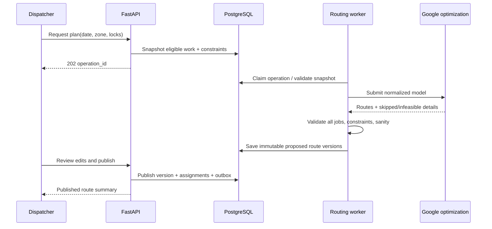

# 05 — Routing, notifications, and tracking

[Documentation index](../README.md) · Previous: [Data model and API](04-data-model-and-api.md) · Next: [Implementation roadmap](06-implementation-roadmap.md)

## 1. MVP routing decision

Use **Google Maps Route Optimization API** as the primary MVP optimizer, behind a provider-neutral routing module. It is selected because the product requires vehicle routing with hard pickup/destination windows plus soft preferred times, capacity, shifts/breaks, service duration, and route start/end. Those constraints are costly to reproduce and tune responsibly in an early operation.

Google is an intentional non-AWS dependency. Before production, validate pricing/quotas, Canadian data handling and contract terms, acceptable-use/storage restrictions, Montreal coverage, and failure modes. Do not imply that optimization makes a route feasible: the application validates inputs and outputs, explains infeasibility, and requires dispatcher review before publication.

## 2. Planning model

### Inputs

- Service date, service zone, planning cutoff, route start/end depots and allowable overtime.
- Eligible confirmed bookings, package count/weight/volume/compatibility, pickup hard window, preferred time and weight, service duration, access difficulty, and return deadline.
- Destination options and opening windows, required handoff service time, authorization/compatibility, and whether pickup-to-destination precedence may span routes/storage.
- Driver shift, mandatory breaks, vehicle capacities, skills/compatibilities, existing load, and maximum configured route duration.
- Travel-time/distance estimates for time of day, plus configurable safety buffers informed by pilot measurements.
- Locked assignments/stop sequences already communicated or physically constrained.

Geocodes below a configured confidence go to an operations queue rather than the solver. Inputs carry a reproducible hash and configuration/model version.

### Hard constraints

- Customer pickup occurs within confirmed window; service begins/ends according to the chosen policy, documented consistently.
- Driver stays within shift/break and vehicle capacity constraints unless an explicit dispatch override policy exists.
- Pickup precedes handoff for each package; package is assigned once per required action.
- Destination arrival occurs while authorized location is open, accounting for service duration.
- Route starts/ends at configured points and respects locked stops, incompatible goods/vehicle rules, and maximum custody/storage rules.

An infeasible job remains visibly unplanned with reason(s). The system never drops it from results to improve the score.

### Soft objectives, in priority order

1. Avoid any hard-window or shift violation (modelled as hard; no tradeoff).
2. Minimize unassigned work and operationally risky slack.
3. Minimize weighted deviation from customer preferred times.
4. Minimize total drive time/distance and overtime.
5. Balance workload and avoid unstable changes to a published/communicated route.

Weights are configuration with experiment history, not magic constants. Report component scores and sensitivity on scenario fixtures before changing them.

### Service-time defaults

Start with conservative, configurable values by stop/building/package type. Measure actual arrival-to-completion distributions, but do not automatically learn from anomalous or unsafe behavior. Re-estimation requires operations review and should use percentiles appropriate to reliability, not only averages.

## 3. Planning workflow

### Route freeze and replanning

- An initial route freeze occurs at a configurable cutoff. Late bookings use remaining capacity and may require dispatcher placement.
- Before publish, optimization can freely reorder within constraints. After publish, a change incurs a stability penalty and creates a new version.
- During active execution, prefer local dispatch intervention over global churn. Reoptimize only affected remaining stops, lock completed/in-progress steps, preserve custody, and explicitly notify the driver/customer where material.
- Drivers acknowledge route versions. Offline devices may finish an already-started safe action; stale future assignments require sync before execution.

## 4. Runtime tracking and ETA

### Location collection

- Collect only for an active, consented shift/route and explain purpose, cadence, recipients, and retention in English/French.
- Mobile sends bounded batches with device capture time, accuracy, speed/source, sequence, and route. Discard or down-weight implausible/stale/low-accuracy samples.
- Stop collecting promptly at shift end, logout, consent withdrawal where feasible, or route completion. The driver UI clearly indicates collection state.
- Dispatch receives current operational position/age/accuracy; customers receive ETA/status, not a live precise driver map or identity unless separately justified.

### ETA calculation

ETA combines current route progress, latest reliable location, road travel estimate, predicted service times for intervening stops, breaks, and known delays. It outputs a range/confidence and `calculated_at`, not a single authoritative promise.

Rules:

- The confirmed hard window remains visible alongside the estimate.
- “About 15 minutes away” triggers only on a downward threshold crossing with acceptable confidence, once per route version/visit unless a material reset is explicitly messaged.
- “About 1 minute away” requires proximity plus route/heading/stop-order sanity; it is suppressed if the driver is paused, location stale, or confidence low.
- Hysteresis prevents repeated alerts when ETA oscillates. A major deterioration triggers a delay message rather than pretending the earlier ETA remains valid.
- Arrival geofence is supporting evidence, not the sole proof; dense buildings and GPS drift require driver action and server validation.

## 5. Notification orchestration

Domain events create a `notification.requested` record through the transactional outbox. A notification policy worker resolves recipient preferences, mandatory/service purpose, locale, template version, quiet-hour rules (where applicable), fallback, dedupe key, and schedule. Channel workers send and persist provider outcomes/receipts.

| Event | Default channels | Notes |
|---|---|---|
| Booking confirmed | Push + email | In-app always; itemized service/receipt links avoid sensitive content in push |
| Reminder | Push; email fallback/configured | Configurable lead time; package-preparation checklist |
| Route/window started | Push | Means driver began assigned route/window, not immediate arrival |
| ~15 minutes | Push | Estimate + timestamp; confidence/throttle gates |
| ~1 minute | Push | Estimate; asks customer to be ready, never to leave package unattended unless supported policy exists |
| Pickup successful | Push + email for durable proof link | Per-package outcome if partial |
| Delay/exception | Push + email when material | Clear next action/support path; do not expose unsafe/internal detail |
| Destination handoff | Push + email | Redacted proof/reference and retailer-refund caveat |
| Payment/subscription issue | Email + in-app; push optional | Never include full payment details |

SMS is not a default MVP dependency. Add it only for defined high-value failures/opt-in needs after consent, cost, Quebec language, provider, and opt-out handling are designed. Email/push templates are application-versioned and professionally bilingual-reviewed.

### Failure behavior

- Transient provider errors retry with exponential backoff/jitter; permanent token errors disable that installation and may select permitted fallback.
- Provider acceptance is not delivery. Capture push receipts/email bounce and complaint signals where supported.
- Dedupe is semantic (`booking + event type + route version/threshold`) and independent from queue delivery ID.
- A notification failure never rolls back pickup/handoff. Exhausted critical messages appear on the operations board and in the customer timeline as appropriate.

## 6. Chain of custody

### Pickup evidence baseline

1. Authenticated assigned driver and current route/stop version.
2. Scan of Returnet token and/or label identifier matched to package; raw barcode data is minimized/redacted.
3. Photo showing sealed package/label context without unnecessary home/person content; customer is guided not to include sensitive unrelated material.
4. Driver/customer preparation attestation and exception reason if any.
5. Device and server timestamps; coarse/precise location only under approved purpose/consent and with accuracy metadata.
6. Immutable custody event plus evidence checksum/storage version and complete audit correlation.

### Destination evidence baseline

- Destination identity and authorized method; package scan; arrival/handoff event; photo/receipt as allowed; carrier tracking/reference when provided; device/server time; permitted location; and driver identity.
- Receipt images are processed/redacted for customer view if they contain other packages/customer data.
- If the carrier provides no receipt, require the configured alternative evidence and mark proof strength honestly.

### Evidence integrity and access

- Direct-to-S3 restricted uploads, checksum verification, quarantine/malware scanning, MIME sniffing, image metadata stripping where appropriate, and server-side encryption with KMS.
- Database stores immutable metadata and append-only corrections. S3 versioning/retention controls match evidence class and approved policy.
- Customers see redacted evidence for their packages; drivers see only work-required evidence; support access is logged; bulk export is privileged.
- A hash chain or periodically signed batch manifest can add tamper evidence. It is not a substitute for authorization, durable storage, or legal advice.

## 7. Offline driver design

- Encrypted local store contains only assigned route data with expiry. App locks behind OS protection and clears safely after retention/sync.
- Each command has a UUID, device sequence, known server/route/package version, capture time, and evidence references. UI distinguishes `saved locally`, `syncing`, `confirmed`, and `needs review`.
- Media uploads are resumable and checksummed. Metadata command waits for confirmed upload or records a controlled pending-evidence state that cannot silently become complete.
- Server processes independent commands in order per package, accepts exact duplicates, rejects impossible transitions, and returns a resolution payload. The client must not overwrite server state with last-write-wins.
- Emergency behavior is documented: if assignment cannot be verified, driver may preserve already-held packages safely but cannot accept a newly presented package unless an approved offline fallback establishes identity and later review.

## 8. Routing test corpus and acceptance

Maintain deterministic Montreal-shaped synthetic scenarios (not real customer data):

- preferred times competing with shortest distance;
- DST boundary and midnight-spanning destination hours;
- last feasible destination before closure;
- multiple packages at one building, different destinations;
- driver break/capacity/shift boundaries;
- impossible window, poor geocode, locked stop, cancellation after publish;
- destination rejection and secure-custody carryover;
- traffic shock/driver delay/partial route and offline location;
- provider timeout, quota, malformed response, and repeat submission.

For every proposal, assert: all input jobs are assigned or explicitly diagnosed; no hard constraint is breached; pickup precedes handoff; route load never exceeds capacity; times use correct timezone; locked work remains stable; output is reproducible within documented provider nondeterminism; and manual edits remain auditable. Pilot acceptance compares planned versus actual time/distance/window performance and records tuning decisions before automated publication is considered.

## 9. Vendor-independent upgrade path

Implement a provider contract with `geocode`, `travel_matrix`, `optimize`, `route_eta`, and normalized diagnostics. The later AWS/self-hosted path uses Amazon Location Service for maps/geocoding/routes and OR-Tools in an ECS worker:

1. Replay the routing corpus and sampled consented/anonymized production shapes against both stacks.
2. Model identical hard/soft constraints and publish score/feasibility/runtime/cost comparisons.
3. Validate matrix limits/batching, time-dependent traffic quality, Quebec address coverage, licensing, and on-call burden.
4. Shadow plans without affecting drivers; dispatch compares and records failures.
5. Switch behind a per-zone feature flag with rollback. Retain normalized plan history so provider changes remain explainable.

Vendor independence is an option earned through a tested abstraction, not a promise that providers are interchangeable.

