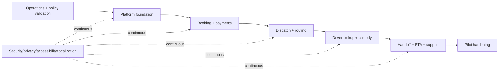

# 06 — Implementation roadmap

[Documentation index](../README.md) · Previous: [Routing, notifications, and tracking](05-routing-notifications-and-tracking.md) · Next: [Test strategy](07-test-strategy.md)

## 1. Delivery approach

Build vertical slices that end in observable operational behavior. Do not implement three frontends and a backend as separate long-running tracks. Every milestone includes English/French content, accessibility, security/privacy, telemetry, migrations, runbooks, and tests for the slice.

Estimates should be produced by the staffed team after discovery. The ordering below expresses dependencies and exit criteria, not calendar promises.

## 2. Phase 0 — Validate the operation and launch gates

**Objectives:** convert uncertain commercial/legal/operational assumptions into owned decisions sufficient for a pilot.

Work:

- Map the Montreal pilot zone, operating days, pickup windows, depot/storage model, destination types/hours, customer contact procedure, and driver shift model.
- Time representative pickups/handoffs; test package scanning/label variants and apartment access.
- Define package eligibility/restricted goods, maximum dimensions/weight, preparation, no-show/cancellation/reschedule, failed drop-off, overnight custody, lost/damaged claim, refund/credit, subscription entitlement, and support escalation policies.
- Obtain qualified Quebec/Canadian review for privacy governance, French-language obligations, consumer/terms disclosures, accessibility applicability, tax/receipts, employment/location consent, insurance/liability, payments, restricted goods, and records retention.
- Validate Stripe/Google/AWS/Expo contracts, accounts, region choices, quotas, pricing, data flows, and subprocessors.
- Threat model the core flows and create a data inventory/retention schedule.

**Exit criteria:** named owners approve pilot operating rules and “must decide before launch” items; a manual end-to-end dry run succeeds; critical third-party feasibility is proven; open issues have dates/owners.

## 3. Phase 1 — Engineering foundation and walking skeleton

**Dependencies:** architecture/IaC decision and provider sandbox accounts.

Work:

- Create monorepo boundaries (API/workers, Next.js web/admin, Expo app, shared generated API clients/localization schemas, IaC) without sharing domain logic into clients.
- CDK provisions development/staging foundations: VPC, ECS/ECR, RDS/PostGIS, S3 quarantine/evidence, SQS/DLQs, Cognito, secrets/KMS, logging/alarms, CloudFront/WAF/ALB as applicable.
- FastAPI health, configuration validation, SQLAlchemy sessions, Alembic baseline, request IDs, structured redacted logging, OpenTelemetry, auth middleware, error envelope, idempotency/outbox primitives.
- Next.js and Expo shells authenticate against distinct clients, switch locale, render accessible design tokens, and call a typed generated client.
- Deterministic seed command and local Compose; CI builds/scans/tests artifacts; deployment and rollback of a feature-flagged hello vertical slice.

**Exit criteria:** a developer can bootstrap from documented steps; CI deploys an immutable build to development; staging smoke verifies auth/API/database/queue/object flow; backup restore and application rollback are rehearsed once.

## 4. Phase 2 — Customer quote, payment, and booking slice

**Dependencies:** policy defaults, service zone/capacity, Stripe test account.

Work:

- Serviceability/geocoding confidence review, address/access notes, package declaration/eligibility, capacity buckets/holds, quotes and policy snapshots.
- Customer web and mobile booking flows in both languages; preparation attestations; accessible errors and recovery.
- Stripe one-time payment and minimal subscription/entitlement model; webhook inbox/dedupe/reconciliation.
- Atomic confirmation, cancellation/reschedule preview and command, outbox, customer timeline, email/push device registration and booking confirmation.
- Admin configuration for zones/windows/capacity/prices/reason codes with audit trail (seeded/read-only admin is acceptable before the full UI if controlled).

**Exit criteria:** acceptance cases AC-01 through AC-05 and payment resilience pass; concurrent last-slot test never oversells; a bilingual customer can complete and reverse the lifecycle in staging; finance reconciles all test transactions.

## 5. Phase 3 — Dispatch and route planning

**Dependencies:** reliable confirmed-booking data, driver/shift setup, Google approval.

Work:

- Destination registry/hours, shifts/vehicles/capacity, planning snapshot and provider abstraction.
- Google optimization adapter with hard/soft constraints, async operation, validation, infeasibility diagnostics, immutable plan versions, cost/quota telemetry.
- Admin board: unassigned/infeasible/at-risk work, map/list proposal, manual sequence/assignment with validation, publish/revise and audit.
- Synthetic routing corpus and simulation harness; operational freeze/replan rules.

**Exit criteria:** all corpus cases pass invariants; every eligible job is assigned or explained; dispatcher can recover provider failure and publish a reviewed route; route versions/overrides are fully auditable.

## 6. Phase 4 — Driver pickup and chain of custody

**Dependencies:** published routes, evidence storage/scanning, mobile development builds.

Work:

- Driver role/assignment authorization, shift and route acknowledgement, stop list/map/navigation handoff, safe contact.
- Scan/photo/evidence pipeline, arrival and per-package pickup transitions, reasoned refusal/no-show/invalid-label flows.
- Encrypted offline command store, resumable uploads, process-restart survival, stale-version/conflict UI, background location consent/indicator.
- Dispatch live progress and exception queue; successful-pickup notifications.

**Exit criteria:** physical iOS/Android tests complete a multi-stop route online/offline; required evidence and audit are complete; unassigned/stale/duplicate commands are safe; privacy/location and mobile-review checks pass.

## 7. Phase 5 — Destination handoff, ETA, and end-to-end operations

**Dependencies:** custody state, destinations/hours, location and routing runtime.

Work:

- Destination stops, receipt/tracking/photo evidence, rejection/closure/alternate/secure-storage/return-to-customer workflows.
- ETA engine with confidence, hysteresis and 15-/1-minute thresholds; route-start, delay, exception, and final-proof orchestration.
- Route reconciliation and partial completion; support cases, proof disputes, lost/damaged incident handling, role-limited refund/credit.
- Customer proof/timeline, privacy redaction/access logging, notification receipt/DLQ tooling.

**Exit criteria:** AC-06 through AC-13 pass; every route/package/financial remainder has an owner/state; ETA simulations do not spam or promise; full bilingual evidence-to-case flow succeeds.

## 8. Phase 6 — Pilot hardening and controlled launch

**Dependencies:** complete product slice and approved launch gates.

Work:

- Load and soak test at agreed pilot envelope; chaos/resilience exercises for database failover, queue backlog, worker/provider outage, push failure, and mobile network loss.
- Accessibility manual audit, bilingual linguistic review, device/OS matrix, penetration test/remediation, dependency/IaC/security review.
- Restore/rollback and incident exercises; on-call rota, dashboards, alerts, runbooks, customer/support scripts, audit/reconciliation exports.
- App Store/Play Store privacy labels/permissions, production provider setup, domain/email reputation, WAF/rate rules, budgets/quotas.
- Staff/driver training and manual shadow days with synthetic then consented pilot work.

**Exit criteria:** all [release acceptance criteria](01-product-requirements.md#6-release-level-acceptance-criteria) and test gates pass or have accountable risk acceptance; rollback and stop-booking controls work; launch review authorizes a capped cohort/zone/window.

## 9. Post-MVP sequence

Prioritize from measured constraints:

1. Reliability/operations: better capacity forecasting, destination/carrier integrations, proof automation, support self-service.
2. Expansion: additional zones/cities/depots and configurable tax/policy, only after data isolation/configuration tests.
3. Optimization independence: Amazon Location + OR-Tools shadow benchmark and potential rollout.
4. Product: subscription tiers, business accounts, same-day service, lockers/label generation.
5. Architecture extraction only where bottlenecks/team ownership justify it (likely notifications, routing, or evidence processing first).

## 10. Workstream dependencies

## 11. Definition of done for every story

- Acceptance behavior and failure/permission cases are explicit and linked to requirement/test IDs.
- Database/API/event changes are backward-compatible, migrated, documented, and generated clients/contracts updated.
- English/French copy and accessibility behavior are reviewed for affected interfaces.
- Logs/metrics/traces/audit contain necessary correlation and no avoidable sensitive data.
- Unit/integration/contract/E2E tests are appropriate; seed/fixtures use synthetic data.
- Feature flag, rollout, rollback/forward-fix, support impact, and runbook/dashboard changes are addressed.
- Security/privacy data-flow impact and retention are reviewed.
- Product/operations accepts the behavior in staging; no silent TODO controls remain on critical custody/payment paths.

## 12. Delivery risks and mitigations

| Risk | Early mitigation |
|---|---|
| Policy remains vague while code hardens assumptions | Versioned configuration and Phase 0 owner/deadline log; block only launch-critical decisions |
| Mobile permissions/offline complexity arrives late | Device spike in Phase 1; full offline pickup in Phase 4 before ETA polish |
| Optimizer masks bad address/operations data | Confidence queue, invariant validator, corpus, manual publish |
| Admin/support tooling is deferred | Each vertical slice includes its operational controls and audit view |
| Provider sandboxes differ from production | Contract tests plus capped production smoke, quota monitoring, reconciliation |
| Migration/rollback neglected | Expand/contract check and staging restore/rollback are milestone gates |
| Scope expands to same-day/multi-city | Enforce MVP boundary; capture measured post-MVP case rather than generalizing prematurely |

